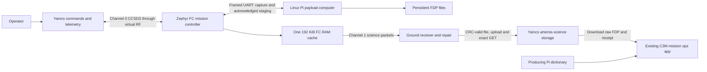

# Artemis local twin architecture

Current branch design and verified behavior, updated 2026-11-12 HST.

The Teensy flight controller owns spacecraft operations; the Pi owns payload
acquisition and persistent products. Yamcs provides commanding, telemetry and
raw-file delivery. The existing C3M application opens the downloaded file and
performs image/temperature analysis.

Two named profiles now select the execution and ground transports:
`yamcs-twin` uses the Docker services below; `yamcs-rfm23-hil` builds Teensy41
RFM23 and Pi Zero W/UVC applications, generates Pi startup inputs and connects
Yamcs to Ground Teensy CDC0/CDC2. It uses the same mission/cache/file components.
The serial adapter bypasses virtual RF framing because the Ground Teensy already
owns it. Build/ELF/QEMU and real Yamcs PTY tests passed; physical bench behavior
remains untested. See the [profile runbook](../development/YAMCS_DEPLOYMENT_PROFILES.md).

## Processes and ownership

Docker Desktop supplies one Linux VM on the Mac. Compose runs four independent
services with separate build/artifact/data volumes. This is a software twin:
the FC runs the Zephyr kernel/application through `native_sim`, while the Pi
runs the Linux F′ payload application. CPU cycles and electrical behavior are
not emulated. Both deployments use pinned F′ v4.4.2; Zephyr is v4.3.0.

| Part | Owns | Main implementation |
|---|---|---|
| FC | Modes, capture admission/scheduling, subsystem control, full cache, radio | `MissionApp`, `ScienceCoordinator`, sensor/power/EPS managers, `RadioComms` |
| Pi | Lepton driver, collection interval, DpWriter/catalog, persistent products, staging | `PayloadManager`, `PayloadDriver_Lepton`, `PayloadLinkService` |
| Devices | Virtual UART pacing, Pi power observation, GPS, packet RF, PDU host firmware | `tools/twin/devices.py`, `Platform/NativeBoard.c`, `tools/twin/pdu_host.c` |
| Ground | RF reception/repair, CRC validation, Yamcs adapter and verified object publication | `tools/twin/ground.py`, `radio_ground.py`, `science_ground.py` |
| Existing C3M app | File import, image display, temperature analysis, History/CSV/PNG | Unchanged `ground-station/c3m-payload-receiver-ui` and existing Lepton decoder |

The existing analysis app runs separately on the Mac when requested. It is not
a fifth automatic Compose service. Yamcs does not automatically decode images.
The ground container cannot mount the Pi product volume.

## Power, capture and staging

1. `missionApp.ENTER_BASE_MODE` enables the FC's Pi power GPIO. In the twin,
   the supervisor starts the Pi application while preserving its UART bridge
   and product volume. Fresh payload READY/heartbeats establish admission.
2. `scienceCoordinator.CONFIGURE_CAPTURE_DURATION` sets the collection interval.
   `missionApp.SCHEDULE_COLLECTION` starts a delayed job; MissionApp owns mode
   policy and ScienceCoordinator enforces freshness, one-job ownership and deadlines.
3. The request crosses the framed FC/Pi GenericHub link on science port index 6.
   Pi forwards it through PayloadManager to the Lepton driver. The recorded
   backend is explicitly selected in this local twin; the driver remains active
   for health handling during the collection interval.
4. Pi serializes one image into an FDP. PRODUCT_COMMITTED requires the matching
   DpWriter completion and persistent metadata; a command acceptance is not a
   completed file. Numeric product handles persist across Pi process restarts.
5. FC requests staging. Pi sends BEGIN, acknowledged chunks up to 200 bytes,
   and COMMIT. Every frame is correlated by session/request/product/generation.
   FC marks CACHE_READY only after all bytes and the whole-file CRC agree.

Partial staging never produces a valid cache. Retries are bounded; duplicated
chunks/commits do not create a new product. Active cancellation uses a dedicated
local driver → manager → service completion signal, so an old result/cancellation
cannot complete or cancel a replacement capture.

## Cache and downlink

There is one fixed **196,608-byte (192 KiB)** FC product buffer, shared by
staging, sending and repair. Current single-frame Lepton files are **38,486
bytes**; capacity and file length are different. The physical Teensy linker
places this buffer in a separate 256 KiB internal OCRAM bank. The main
application occupies the independent 512 KiB OCRAM2 bank; the aliases must not
be double-counted.

`missionApp.REQUEST_SCIENCE_DOWNLINK` reads the committed RAM buffer. The single
radio manager services command/telemetry and science, with independent channel
framing/state. Ground requests missing science packets from that same retained
cache. Pi can be OFF throughout send and repair. Channel 1 does not use a link
ACK for every segment; application repair and ground CRC establish receipt.

CACHE_READY means the FC has verified all staged bytes. SENT means the sender
finished its local transmission. A verified ground receipt means the ground
received the full file, checked CRC, uploaded it to Yamcs and independently
retrieved identical bytes. These are separate milestones.

Starting a replacement stage invalidates the previous cache in place; there is
no second full-size buffer. A reset invalidates RAM-cache metadata even if its
NOLOAD bytes remain. Pi files survive process/container restarts, and explicit
`scienceCoordinator.RESTAGE_PRODUCT` can reload an indexed retained product
when Pi is available. Cancelling collection retains committed Pi files.

## Raw file contract and C3M handoff

Only complete CRC-valid files enter Yamcs bucket `artemis-science`. Publication
runs in a bounded worker so a slow/unavailable Yamcs server does not block RF
reception. The object is the original FDP; its receipt records product/transfer,
size, CRC16, SHA-256, run ID and producing-dictionary hash. Partial/bad-CRC files
remain reception diagnostics.

The Pi producer preserves the existing C3M Lepton **container and record IDs
0x10027000**, each derived from its component base plus local ID zero. The Pi
link buffer manager uses **0x10034000**. These public file identities are not
Docker container identities, and differ from the per-capture numeric product
handle in transport metadata.

Download the FDP and receipt in Yamcs Storage. Give the existing C3M app that
file and the matching **Pi dictionary** in the run's `ground/dictionaries/pi.json`.
Do not substitute the FC dictionary or assume the legacy dictionary selected by
an older launcher matches the new producing deployment. Prior files produced
before the ID correction retain their former identity.

The unchanged app's existing `--replay-fdp` option opens a local file through
its parser, without hardware. This is a separate post-download analysis action;
it does not make the app a second live receiver for the twin's radio.

## Evidence and limits

- Fresh products 16/17/18 passed the full Yamcs capture/cache/downlink/GET flow.
- Product 19 passed after Pi power OFF and one missing-packet repair round.
- All four downloads passed the unchanged C3M app using its existing F′ tools
  4.2.1 environment: complete Lepton History, 120×160 CSV, all 19,200 fixture
  temperatures equal and PNG output; app source hashes remained unchanged.
- The app was also opened in the browser with the downloaded product 19. Current
  showed Payload complete/CRC passed and the thermal image; History showed
  Complete, archived image, statistics and output links. The local replay assigns
  its own display product 1/transfer 42; the downloaded source is product 19.
- Both Teensy target links passed. RFM23 static reservations including cache are
  44.35% of 1 MiB physical RAM; USB is 44.76%. Runtime target heap/stack peaks,
  physical peripheral/RF behavior and sustained timing remain bench gates.
- Existing GPS, IMU and seven TMP36 paths have device models. INA219/LIS3MDL
  acquisition remain follow-up work. Recorded Lepton is not physical-camera proof.
- CI/CD, FreeRTOS porting and hardware deployment are outside this branch's work.

## Documentation map

| Need | Document |
|---|---|
| Named twin/HIL build and runtime profiles | [Profile runbook](../development/YAMCS_DEPLOYMENT_PROFILES.md) |
| Physical-target commands and remaining deployment gates | [Hardware handoff status](../development/ARTEMIS_HARDWARE_HANDOFF.md) |
| Start/build/stop and fault controls | [Runtime runbook](../../tools/twin/README.md) |
| Power → capture → cache → downlink → download → existing app | [Operator walkthrough](../operations/walkthroughs/C3M_YAMCS_LOCAL_TWIN.md) |
| Decisions, milestones and detailed test provenance | [Milestone record](../development/ARTEMIS_LOCAL_TWIN.md) |
| Exact post-ID-fix builds, files and unchanged-app hashes | [Compatibility evidence](../development/evidence/ARTEMIS_C3M_ID_COMPATIBILITY_2026-11-11.json) |
| Full twin/fault and target-memory summary | [Baseline acceptance evidence](../development/evidence/ARTEMIS_LOCAL_TWIN_ACCEPTANCE_2026-11-11.json) |
| Cache/link implementation contracts | [Science core](../../fprime-artemis-core/FprimeArtemisCore/Science/README.md) |

The feature branch is intended for review into `zephyr-dev`, followed by a
separate integration into `main`. Branch publication is authorized; neither
merge nor physical hardware operations are part of this publication step.
