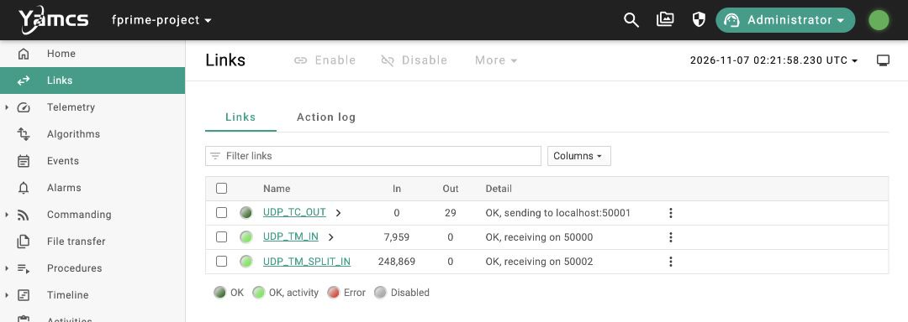
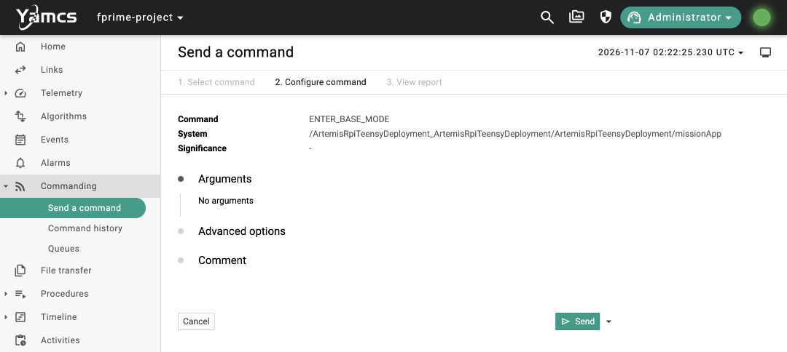
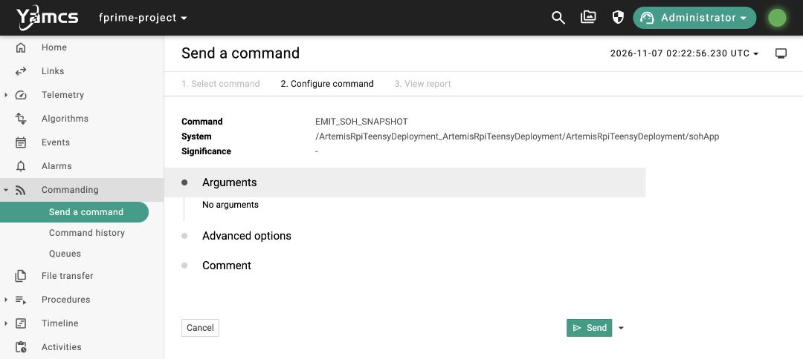
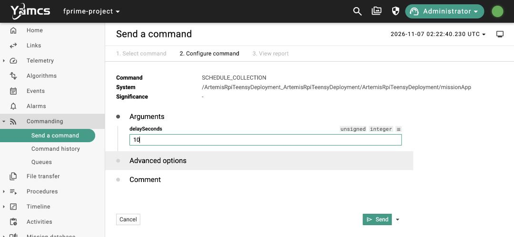
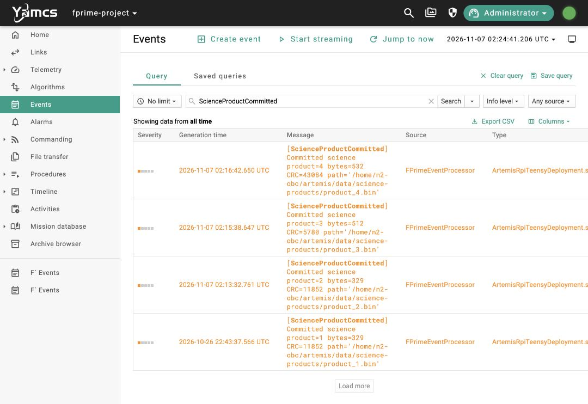
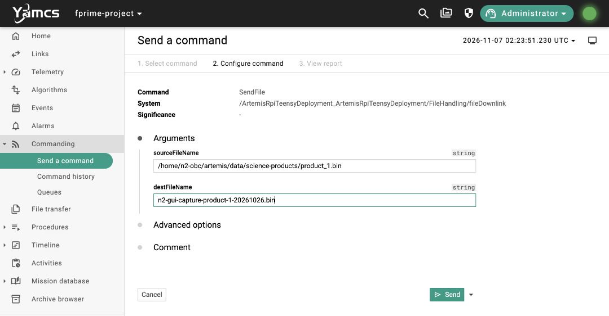
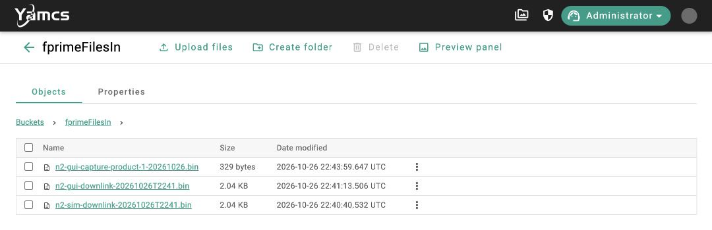
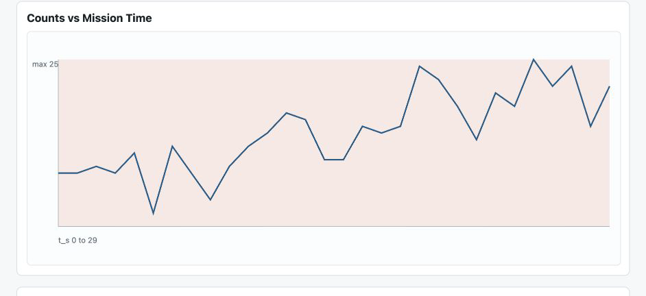

# N2 FlatSat FSR rehearsal in Yamcs

Start in **Base**, check state of health (SOH) on the first mock pass, schedule a capture, then request and review the science file on the second pass.

This rehearsal uses the deployed **Pi 5 Yamcs → Pi Zero W F′** bench over LAN, with a simulated payload and operator-called passes. The full FSR sequence adds payload power and standby and the SatNOGS/SDR path. [FSR system sequence](../../architecture/SYSTEM_ARCHITECTURE.md#december-fsr-scheduled-mode-and-power-sequence)

The screenshots show the deployed command forms and an archived capture and downlink. The complete scheduled sequence still needs a live rehearsal. [October 26 bench record](../../integration/N2_GROUND_DEPLOYMENT_2026-10-21.md#october-26-two-pi-update-and-synthetic-capture)

## Start the rehearsal

1. Join the FlatSat LAN and open [Yamcs](http://192.168.0.203:8090/). Sign in with a commanding account and select **fprime-project / realtime**.
2. In **Links**, check that `UDP_TC_OUT` is **OK** and the **In** counter for `UDP_TM_IN` is increasing. Coordinate with the bench operator before starting.
3. For each command below, use **Commanding → Send a command**. Open `ArtemisRpiTeensyDeployment_ArtemisRpiTeensyDeployment/`, then `ArtemisRpiTeensyDeployment/` for `missionApp`, `sohApp`, and `scienceApp`. Select the command, fill its arguments if any, and click **Send**.



## 1. Prepare in Base

With the bench idle, send `missionApp.ENTER_BASE_MODE`. Open **Events** and confirm a fresh `ModeChanged` to `BASE`. Use **Jump to now** if the latest events are outside the displayed range.



## 2. Check SOH and schedule the capture on the first pass

1. Send `sohApp.EMIT_SOH_SNAPSHOT`. In **Events**, open the fresh `Snapshot` and check the reported health against the expected bench state.

   

2. Send `scienceApp.CONFIGURE_CAPTURE_DURATION` with `durationSeconds = 10`. This sets the amount of simulated science data.

   

3. Send `missionApp.SCHEDULE_COLLECTION` with `delaySeconds = 10`. In **Events**, confirm `CollectionScheduled` shows the 10-second countdown.

   

## 3. Wait for the onboard product

In **Events**, look for the `ModeChanged` events through `COLLECTION_PENDING → COLLECTING → SCIENCE_READY`. Wait for a fresh `ScienceProductCommitted`. Copy its **path** and note its **byte count**. After the product commits, send `missionApp.ENTER_BASE_MODE` to mark the end of the collection phase on this bench.



## 4. Request science on the second pass and verify receipt

Send `sohApp.EMIT_SOH_SNAPSHOT` again. Under the top-level command folder, select **FileHandling → fileDownlink → SendFile** and fill both fields.

| Field | Enter |
| --- | --- |
| `sourceFileName` | The exact onboard path from `ScienceProductCommitted` |
| `destFileName` | A new name for this run, such as `fsr-product-7-run-1.bin` |



Click **Send**. In **Events**, look for `FileSent` with your destination name. Click the **Storage** icon in the top bar, open **fprimeFilesIn**, and click your file name to download it. Match the downloaded file size to the commit event.



## Open simulated counts in the Neutron 2 Payload Viewer

From the `neutron_2` repo root on your computer, run the command below with the path to the file you downloaded from Yamcs. The viewer accepts neutron-count CSV data saved as either `.csv` or `.bin`.

**macOS**

```sh
python3 ground-station/neutron2-payload-viewer/neutron2_payload_viewer.py \
  --file "$HOME/Downloads/fsr-product-7-run-1.bin"
```

**Windows PowerShell**

```powershell
py -3 ground-station\neutron2-payload-viewer\neutron2_payload_viewer.py --file "$HOME\Downloads\fsr-product-7-run-1.bin"
```

The viewer opens at [localhost:8062](http://127.0.0.1:8062/). Leave the terminal running while you review the counts and plot. The example below shows product 1 from the October 26 bench run. [Viewer README](../../../ground-station/neutron2-payload-viewer/README.md)



## Open real science data in Control.jar

For a file from the real payload, use the payload team's Java app. With Java installed, open a terminal in the folder containing `Control.jar` and run:

```sh
java -jar Control.jar
```

In the app, open the original file you downloaded from Yamcs.
